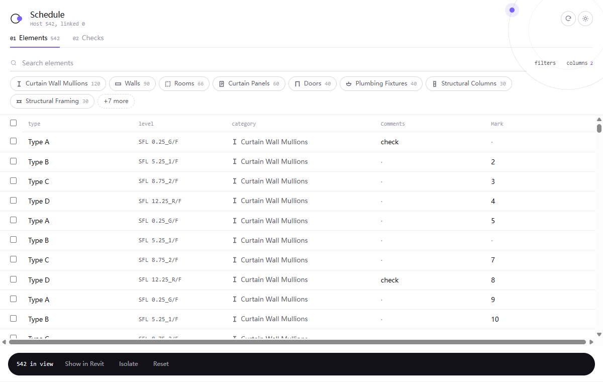
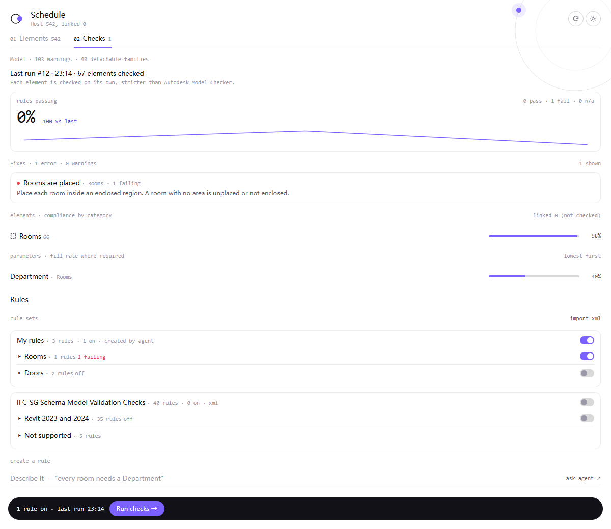

https://github.com/user-attachments/assets/71c89c47-0042-4bf9-acdb-9932ade8c099

# Revit MCP Server Apps

Based on [mcp-servers-for-revit](https://github.com/mcp-servers-for-revit/mcp-servers-for-revit).

This fork keeps the original Revit MCP bridge (server + plugin + command set) and adds **MCP Apps UI**, **model checks**, **Revit 2027** support, and tools for querying, navigating, and editing the model from Cursor / other MCP clients.

The Schedule App is a **HITL (human-in-the-loop) workflow**: the AI opens and loads model data; **you** review, filter, edit, run checks, and confirm before writes go back to Revit.

## What’s new in this fork

### MCP Apps · Schedule (`mcp_apps_get_schedule_data`)

Interactive schedule UI (Ultraviolet theme, light / dark) with two tabs:

| Tab | Role |
| --- | --- |
| **01 Elements** | Filterable table of host (+ linked) instances; editable instance parameters; pending edits before Apply |
| **02 Checks** | Model warnings, the last check run (pass rate, trend, fixes), then the rules to import, switch and run |





**01 Elements**

- Editable instance parameters (skips calculated quantities like Area / Volume)
- Search + filters (category / level / family / type / link) and **columns** multi-select
- Cell selection border; drag the fill handle to paint values down a column
- Double-click to edit → the dock shows `n unsaved ▴`: open it to review or remove each pending edit, then Apply writes
  back via `SetParameter` / `ChangeType` (Discard drops them; a reload resets them)
- Dock: Show in Revit / Isolate / Reset; section-box and category-aware selection helpers
- Linked rows stay read-only for edits

**02 Checks** (one page, top to bottom)

- Model line: warnings and detachable families
- Last run: pass rate with trend, fixes with severity counts, compliance by category, parameter fill rate
- Rules: import Autodesk Model Checker checksets (`.xml`, e.g. IFC-SG) or create rules via the agent; switch them on
  and Run checks against the open host model; results stored per project in SQLite
- Suggestions are guidance only — edits still happen in **01** (no auto-fix writeback)

### Why MCP Apps (vs plain Read / Write tools)

MCP Apps and normal MCP tools solve different jobs. Use both. The Schedule App is explicitly a **HITL** path: AI assists with loading/context; humans stay in control of review and apply.

| | **MCP Apps** (Schedule UI, HITL) | **Read / Write tools** (`query_model`, `operate_element`, …) |
|---|---|---|
| Who drives | **You** — click, filter, edit, drag-fill, then Apply | **The AI** — call tools from chat |
| Workflow | Human-in-the-loop: inspect → edit → confirm | Agent-driven: prompt → tool → result |
| Best for | Scan a table, pick columns, tweak params, review check results | Automation: “set all door Marks…”, scripted workflows |
| Feedback | Live table / dashboard in the client | JSON / text back in the conversation |

**Tokens**

- App: load once into the UI; filtering, column picks, and cell edits stay in the frontend — they do **not** re-enter the model context on every click.
- Tools-only: large tables often get pasted into chat; each “read → decide → write” loop burns another round of tokens.

**Rule of thumb:** HITL table / check review → MCP Apps; hands-off automation → tools. Open the Schedule App, then let tools handle scripted follow-ups.

### Model checks (server)

Rule engine lives in the Node MCP server (`server/src/checks/`):

- Parse Model Checker XML → validated rule JSON
- Collect host-model element/parameter data from Revit (read-only)
- Evaluate rules → pass/fail + fix text
- Persist rulesets and run history in SQLite (`revit-data.db`)

Chat-facing tool results stay **summary-sized**; the App dashboard loads full detail via structured content.

### Revit 2020–2027

- Plugin + command set configs for **R20–R27** (including Revit 2027)
- Debug deploy under `%AppData%\Autodesk\Revit\Addins\<year>\...`

### New / extended tools

| Tool | Description |
| ---- | ----------- |
| `mcp_apps_get_schedule_data` | MCP Apps schedule UI (Elements / Checks) |
| `rules_import_checkset` | Import a Model Checker `.xml` checkset |
| `rules_upsert` | Create or update custom rules (e.g. from natural language) |
| `rules_list` | List rulesets / rules |
| `rules_set_enabled` | Enable or disable rules |
| `checks_run` | Run enabled rules against the open host model |
| `checks_get_results` | Latest (or specific) run summary + trend |
| `query_model` | Multi-criteria element query |
| `get_element_data` | Element info + parameter modes including `EditableInstanceParameters` |
| `select_elements` | Select elements by Id |
| `zoom_to_elements` | Zoom to elements |
| `open_view` | Open a view by Id |
| `export_views` | Export views |
| `get_running_revit_instances` | List running Revit processes / open documents |
| `operate_element` | Extended with `ChangeType` and `SetParameter` |

Existing upstream tools (create / tag / color / room export / etc.) remain available.

## Requirements

- **Node.js 20+** (MCP server)
- **Autodesk Revit 2020–2027**
- An MCP client that supports **MCP Apps** (e.g. Cursor) for the schedule UI

## Quick start (local)

### 1. Build the MCP server

```bash
cd server
npm install
npm run build
```

Point your client at `server/build/index.js`, for example Cursor `mcp.json`:

```json
{
  "mcpServers": {
    "mcp-server-for-revit": {
      "command": "node",
      "args": ["C:/path/to/Revit-MCP-Server-Apps/server/build/index.js"]
    }
  }
}
```

### 2. Build & install plugin + command set

```bash
# Revit 2027
dotnet build commandset/RevitMCPCommandSet.csproj -c "Debug R27"
dotnet build plugin/RevitMCPPlugin.csproj -c "Debug R27"

# Revit 2026
dotnet build commandset/RevitMCPCommandSet.csproj -c "Debug R26"

# Revit 2023
dotnet build commandset/RevitMCPCommandSet.csproj -c "Debug R23"
dotnet build plugin/RevitMCPPlugin.csproj -c "Debug R23"
```

Debug builds copy into:

```
%AppData%\Autodesk\Revit\Addins\<year>\revit_mcp_plugin\
```

Then open Revit → ribbon **MCP On** → call `mcp_apps_get_schedule_data` from the client.

Typical HITL loop: open the App → edit in **01** and review the unsaved list → import rules & **checks_run** → read the results in **02 Checks** → fix in **01**.

## Project layout

```
├── server/                 # MCP server + MCP Apps
│   ├── mcp-app/            # Schedule app UI (HTML/TS)
│   ├── src/mcpApp.ts       # App tool + UI resource
│   └── src/checks/         # Rules, collector, engine, store, MCP tools
├── plugin/                 # Revit add-in (socket bridge, MCP toggle)
├── commandset/             # Revit API commands
├── command.json
├── BACKLOG.md              # Parked ideas
└── LICENSE
```

## License

[MIT](LICENSE) — see original project: [mcp-servers-for-revit](https://github.com/mcp-servers-for-revit/mcp-servers-for-revit).
