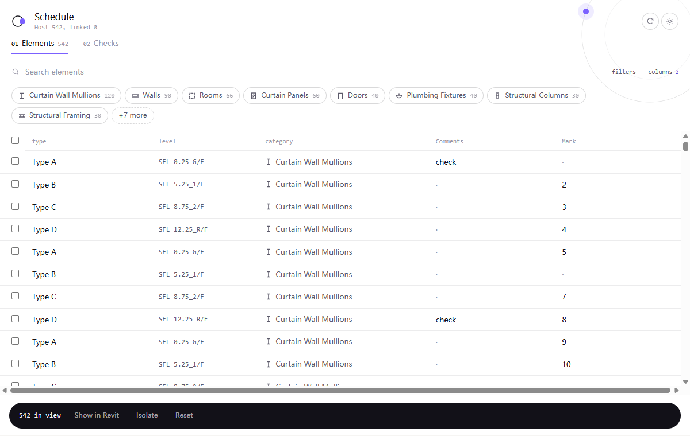
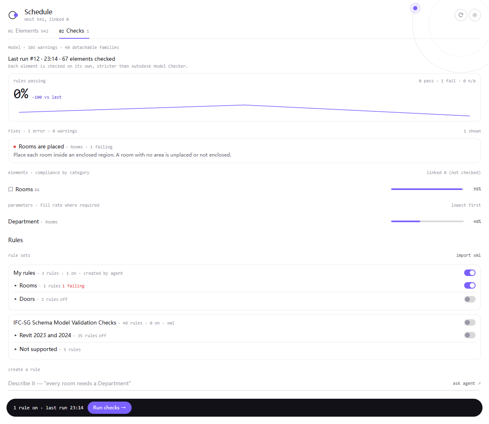

https://github.com/user-attachments/assets/71c89c47-0042-4bf9-acdb-9932ade8c099

# Revit MCP Server Apps

Based on [mcp-servers-for-revit](https://github.com/mcp-servers-for-revit/mcp-servers-for-revit).

This fork keeps the original Revit MCP bridge (server + plugin + command set) and adds **MCP Apps UI**, **model checks**, **MEP tools** (pipes, ducts, cable trays, fittings), **Revit 2027** support, and tools for querying, navigating, and editing the model from Cursor / other MCP clients.

The Schedule App is a **HITL (human-in-the-loop) workflow**: the AI opens and loads model data; **you** review, filter, edit, run checks, and confirm before writes go back to Revit.

## What’s new in this fork

### MCP Apps · Schedule (`mcp_apps_get_schedule_data`)

Interactive schedule UI (Ultraviolet theme, light / dark) with two tabs:

| Tab | Role |
| --- | --- |
| **01 Elements** | Filterable table of host (+ linked) instances; editable instance parameters; pending edits before Apply |
| **02 Checks** | Model warnings, the last check run (pass rate, trend, fixes), then the rules to import, switch and run |





**01 Elements**

- Editable instance parameters (skips calculated quantities like Area / Volume)
- Search + filters (category / level / family / type / link) and **columns** multi-select
- Cell selection border; drag the fill handle to paint values down a column
- Double-click to edit → the dock shows `n unsaved ▴`: open it to review or remove each pending edit, then Apply writes
  back via `SetParameter` / `ChangeType` (Discard drops them; a reload resets them)
- Dock: Show in Revit / Isolate / Reset; section-box and category-aware selection helpers
- Linked rows stay read-only for edits

**02 Checks** (one page, top to bottom)

- Model line: warnings and detachable families
- Last run: pass rate with trend, fixes with severity counts, compliance by category, parameter fill rate
- Rules: import Autodesk Model Checker checksets (`.xml`, e.g. IFC-SG) or create rules via the agent; switch them on
  and Run checks against the open host model; results stored per project in SQLite
- Suggestions are guidance only — edits still happen in **01** (no auto-fix writeback)

### Why MCP Apps (vs plain Read / Write tools)

MCP Apps and normal MCP tools solve different jobs. Use both. The Schedule App is explicitly a **HITL** path: AI assists with loading/context; humans stay in control of review and apply.

| | **MCP Apps** (Schedule UI, HITL) | **Read / Write tools** (`query_model`, `operate_element`, …) |
|---|---|---|
| Who drives | **You** — click, filter, edit, drag-fill, then Apply | **The AI** — call tools from chat |
| Workflow | Human-in-the-loop: inspect → edit → confirm | Agent-driven: prompt → tool → result |
| Best for | Scan a table, pick columns, tweak params, review check results | Automation: “set all door Marks…”, scripted workflows |
| Feedback | Live table / dashboard in the client | JSON / text back in the conversation |

**Tokens**

- App: load once into the UI; filtering, column picks, and cell edits stay in the frontend — they do **not** re-enter the model context on every click.
- Tools-only: large tables often get pasted into chat; each “read → decide → write” loop burns another round of tokens.

**Rule of thumb:** HITL table / check review → MCP Apps; hands-off automation → tools. Open the Schedule App, then let tools handle scripted follow-ups.

### Model checks (server)

Rule engine lives in the Node MCP server (`server/src/checks/`):

- Parse Model Checker XML → validated rule JSON
- Collect host-model element/parameter data from Revit (read-only)
- Evaluate rules → pass/fail + fix text
- Persist rulesets and run history in SQLite (`revit-data.db`)

Chat-facing tool results stay **summary-sized**; the App dashboard loads full detail via structured content.

### MEP (pipes, ducts, cable trays)

Dedicated command set (`mep-commandset`) plus MCP tools for listing types/systems/instances, creating and modifying straight runs, and placing fittings. Lengths and sizes are **millimeters**. Prefer these over `send_code_to_revit` for MEP work. Needs the **v1.1.0+** release zip (includes `RevitMCPMEPCommandSet`).

### Revit 2020–2027

- Plugin + command sets for **R20–R27** (architecture command set + MEP command set)
- Debug deploy under `%AppData%\Autodesk\Revit\Addins\<year>\...`

## MCP tools

Prefer dedicated tools before `send_code_to_revit`. Coordinates and sizes are millimeters unless noted.

### Query & inspect

| Tool | Description |
| ---- | ----------- |
| `query_model` | Multi-criteria element query → Ids + analysis counts |
| `get_element_data` | Element info / parameters (incl. `EditableInstanceParameters`) |
| `ai_element_filter` | Category / type / visibility / spatial filter for AI follow-up |
| `get_current_view_info` | Active view type, name, scale, etc. |
| `get_current_view_elements` | Elements in the active view (model or annotation) |
| `get_selected_elements` | Current selection |
| `get_available_family_types` | Loaded family types (filter by category / name) |
| `analyze_model_statistics` | Element / type / family / view / sheet counts |
| `get_material_quantities` | Material takeoff (area, volume, counts) |
| `export_room_data` | Room schedule-style export |
| `get_running_revit_instances` | Running Revit processes / open documents |

### Navigate & views

| Tool | Description |
| ---- | ----------- |
| `select_elements` | Select by Id |
| `zoom_to_elements` | Zoom / focus the view on Ids |
| `open_view` | Open a view by Id |
| `export_views` | Export views / sheets to image, PDF, or schedule CSV |
| `color_elements` | Color by category + parameter value in the current view |

### Create

| Tool | Description |
| ---- | ----------- |
| `create_grid` | Grid system (X/Y, alphabetic or numeric) |
| `create_level` | Levels at elevations |
| `create_room` | Place rooms |
| `create_point_based_element` | Doors, windows, furniture, … |
| `create_line_based_element` | Walls, beams, … |
| `create_surface_based_element` | Floors, ceilings, roofs |
| `create_structural_framing_system` | Beam system in a rectangular boundary |
| `create_dimensions` | Dimension annotations |

### Edit & operate

| Tool | Description |
| ---- | ----------- |
| `operate_element` | Select / Hide / Delete / SetColor / Highlight / Isolate / ResetOverride / ChangeType / SetParameter |
| `delete_element` | Delete by Id |
| `tag_all_rooms` | Tag all rooms in the active view |
| `tag_all_walls` | Tag all walls in the active view |

### MEP — pipes, ducts, cable trays

| Tool | Description |
| ---- | ----------- |
| `get_pipe_types` / `get_duct_types` / `get_cable_tray_types` | List loaded types |
| `get_pipe_system_types` / `get_duct_system_types` | List system types (for `systemTypeId`) |
| `get_pipes` / `get_ducts` / `get_cable_trays` | List instances (mm) |
| `create_pipe` / `create_duct` / `create_cable_tray` | Straight run between two points |
| `modify_pipe` / `modify_duct` / `modify_cable_tray` | Move ends, change type or size |
| `create_mep_fitting` | Generic elbow / transition / union / tee / takeoff (`class`: pipe \| duct \| cable_tray) |
| `create_pipe_*_fitting` | Pipe elbow, transition, union, tee, cross, takeoff |
| `create_duct_*_fitting` | Duct elbow, transition, union, tee, cross, takeoff |
| `create_elbow_fitting` / `create_transition_fitting` / `create_union_fitting` / `create_tee_fitting` / `create_cross_fitting` | Cable tray fittings |

### Model checks

| Tool | Description |
| ---- | ----------- |
| `rules_import_checkset` | Import a Model Checker `.xml` checkset |
| `rules_upsert` | Create or update custom rules |
| `rules_list` | List rulesets / rules |
| `rules_set_enabled` | Enable or disable rules |
| `checks_run` | Run enabled rules on the open host model |
| `checks_get_results` | Latest (or specific) run summary + trend |

### MCP Apps & storage

| Tool | Description |
| ---- | ----------- |
| `mcp_apps_get_schedule_data` | Schedule UI (Elements / Checks) |
| `store_project_data` | Persist project metadata in local SQLite |
| `store_room_data` | Persist room metadata for a project |
| `query_stored_data` | Query the local store |
| `say_hello` | Connection smoke test dialog in Revit |

### Escape hatch

| Tool | Description |
| ---- | ----------- |
| `send_code_to_revit` | **Last resort** — C# when no dedicated tool covers the API |

## Install

Two pieces. The [release zip](https://github.com/jesselei1102-hue/Revit-MCP-Server-Apps/releases/latest) is the Revit add-in. The MCP server is this repo, built with Node and started by Cursor. They talk on `localhost:8080`.

You need **Node.js 20+**, **Revit 2020–2027**, and an MCP client that can show MCP Apps (Cursor).

### 1. Revit add-in

1. Close Revit.
2. From the [latest release](https://github.com/jesselei1102-hue/Revit-MCP-Server-Apps/releases/latest), download the zip for your Revit year. The name looks like `mcp-servers-for-revit-v1.1.0-Revit2026.zip`.
3. Unzip it into that year's Addins folder:

```
%AppData%\Autodesk\Revit\Addins\<year>\
```

Revit 2026 is `C:\Users\<you>\AppData\Roaming\Autodesk\Revit\Addins\2026\`. The year folder must contain `mcp-servers-for-revit.addin` and `revit_mcp_plugin\` next to each other. If Extract All wrapped them in an extra folder, move those two items up.

4. Start Revit and open a project. On the **Add-Ins** tab, panel **Revit MCP Plugin**, click **MCP Off**. The button switches to **MCP On** and listens on port **8080**.

### 2. MCP server in Cursor

```bash
git clone https://github.com/jesselei1102-hue/Revit-MCP-Server-Apps.git
cd Revit-MCP-Server-Apps/server
npm install
npm run build
```

`better-sqlite3` compiles a native module. If `npm install` fails on it, install the Visual Studio C++ build tools and run `npm install` again.

Point Cursor at the built server. Use the project file `.cursor/mcp.json`, or the user file `%USERPROFILE%\.cursor\mcp.json`:

```json
{
  "mcpServers": {
    "mcp-server-for-revit": {
      "command": "node",
      "args": ["C:/path/to/Revit-MCP-Server-Apps/server/build/index.js"]
    }
  }
}
```

Use your real path, with forward slashes. Reload MCP servers in Cursor.

### 3. Open the schedule

Revit is open, the button says **MCP On**, and a model is open. In chat, ask to open the schedule (`mcp_apps_get_schedule_data`).

Typical loop: edit in **01** and review the unsaved list → import rules and run checks → read **02 Checks** → fix back in **01**.

### Build the plugin yourself

Skip this if you installed the release zip. Debug builds copy the add-in into `%AppData%\Autodesk\Revit\Addins\<year>\`. Replace `R26` with `R20`–`R27` to match your Revit year, then restart Revit.

```bash
dotnet build commandset/RevitMCPCommandSet.csproj -c "Debug R26"
dotnet build mep-commandset/RevitMCPMEPCommandSet.csproj -c "Debug R26"
dotnet build plugin/RevitMCPPlugin.csproj -c "Debug R26"
```

## Project layout

```
├── server/                 # MCP server + MCP Apps
│   ├── mcp-app/            # Schedule app UI (HTML/TS)
│   ├── src/tools/          # MCP tools (incl. mep.ts)
│   ├── src/mcpApp.ts       # App tool + UI resource
│   └── src/checks/         # Rules, collector, engine, store, MCP tools
├── plugin/                 # Revit add-in (socket bridge, MCP toggle)
├── commandset/             # Core Revit API commands
├── mep-commandset/         # MEP pipes / ducts / cable trays / fittings
├── BACKLOG.md              # Parked ideas
└── LICENSE
```

## License

[MIT](LICENSE) — see original project: [mcp-servers-for-revit](https://github.com/mcp-servers-for-revit/mcp-servers-for-revit).
